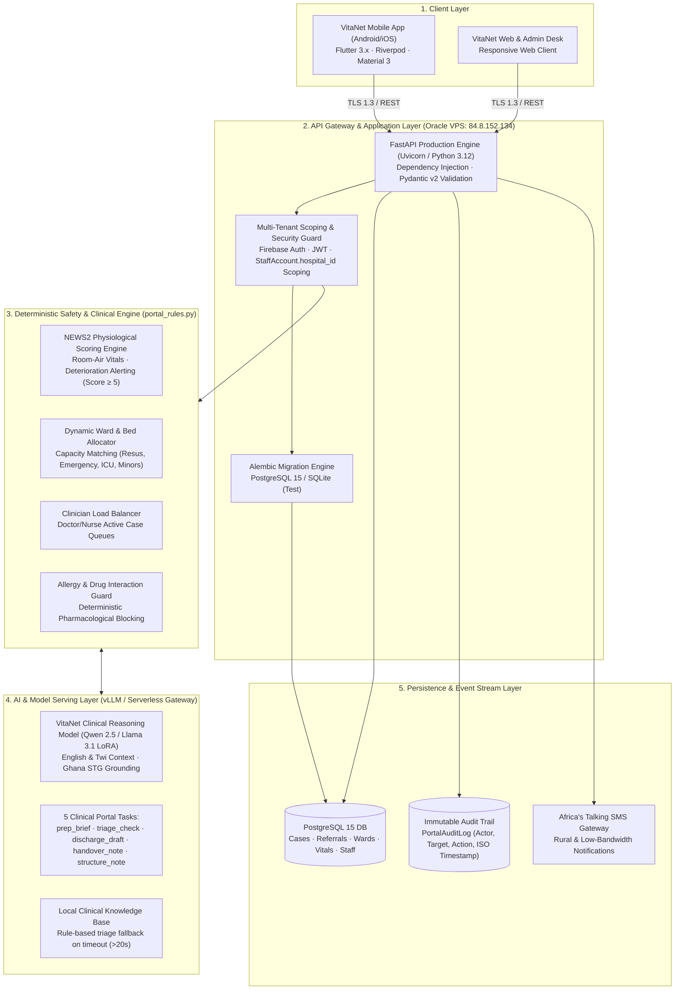

# VitaNet — Enterprise Clinical Triage & Hospital Portal Platform

[](https://flutter.dev)
[](https://fastapi.tiangolo.com)
[](https://python.org)
[](https://postgresql.org)
[]()
[]()

VitaNet is a production-grade, two-sided acute care coordination platform engineered for the Ghanaian healthcare ecosystem. It links patients experiencing acute medical symptoms directly to hospital emergency departments through an end-to-end clinical workflow: **Patient Mobile Triage ➔ Consented Pre-Arrival Referral ➔ Hospital A&E Intake ➔ Bedside Clinical Management ➔ SBAR Shift Handover ➔ Safe Discharge Planning**.

---

## 🏛️ System Architecture



---

## 🏥 Clinical Workflow & Core Engines

### 1. Two-Sided Referral & Case State Machine
VitaNet manages patient lifecycles through a strict clinical state machine ensuring zero unmonitored cases:

```
[Patient Mobile App]
  └─► Triage Flagged (urgent / doctor)
        └─► Patient Consents to Share Summary
              └─► Referral Created (status: new, includes live ETA & Biometrics)

[Hospital Staff Portal]
  ├─► Referral Inbox (Nurse Reviews `prep_brief`, bed availability, red flags)
  │     ├─► Accept ──► Case Created (status: expected, bed reserved)
  │     └─► Decline ─► Patient notified + routed to next nearest A&E
  │
  ├─► Patient Arrives ──► Case status: waiting (in waiting area / triage desk)
  ├─► Clinician Sees ───► Case status: treatment (vitals recorded, notes on timeline)
  └─► Resolution ───────► Case status: discharged (home | admitted | transferred | left)
```

### 2. Deterministic Early Warning Scoring (NEWS2)
Implemented in [`app/services/portal_rules.py`](./vitanet-backend/app/services/portal_rules.py):
* Validates physiological vital measurements: Respiratory Rate, Oxygen Saturation ($\text{SpO}_2$), Systolic Blood Pressure, Heart Rate, Temperature, and Alertness (AVPU).
* Flags acute clinical deterioration automatically when $\text{NEWS2} \ge 5$ or whenever any individual vital parameter triggers a 3-point critical band ($\text{SpO}_2 < 92\%$, Systolic $\text{BP} < 90\text{ mmHg}$, or $\text{Heart Rate} > 130\text{ bpm}$).

### 3. Capacity & Clinician Workload Optimization
* **Ward Suggestion (`suggest_ward`)**: Prioritizes `Resus` and `Emergency` wards for `urgent` cases; routes to `ICU` only when critical care beds are confirmed free; dynamically matches overflow beds.
* **Clinician Load Balancing (`suggest_assignee`)**: Computes real-time active patient counts per on-duty doctor/nurse and auto-routes new cases to clinicians with the lowest case load.

---

## 🧠 Clinical AI Model Architecture

The active model is trained as a standalone foundation in [`C:\Users\CARLVYN\Desktop\Vitanet AI Model\vitanet-model`](file:///C:/Users/CARLVYN/Desktop/Vitanet%20AI%20Model/vitanet-model) and interfaces with the backend via [`docs/portal-ai-model-spec.md`](./docs/portal-ai-model-spec.md) and [`docs/AI_MODEL_INTEGRATION_PLAN.md`](./docs/AI_MODEL_INTEGRATION_PLAN.md).

### The 5 Clinical Task Contracts

| Task | Purpose | Key Inputs | Key Outputs | Hard Constraints |
|---|---|---|---|---|
| `prep_brief` | Pre-arrival nurse preparation | Vitals, ETA, allergies, complaint, ward capacity | `possible_conditions` (≤3), `red_flags`, `prepare` (3–6 items), `avoid`, `suggested_ward` | Output must strictly respect patient allergies; zero invented vitals. |
| `triage_check` | Emergency walk-in evaluation | Age, sex, complaint, vitals (pain 0-10, alert) | `level` (urgent/doctor/routine), `reasons`, `red_flags_to_watch`, `first_steps` | Automatic escalation to `urgent` if $\text{SpO}_2 < 92\%$ or systolic $\text{BP} < 90$. |
| `discharge_draft` | Patient-facing recovery plan | Outcome, admission history, medicines given | `summary`, `what_next`, `medicines`, `warning_signs`, `follow_up` | Written at a **12-year-old reading level**; warning signs include Ghana 112/193 numbers. |
| `handover_note` | Shift handover note (SBAR) | Patient record, latest vitals, pending orders | `situation`, `background`, `assessment`, `recommendation`, `pending` | Each section capped at 160 characters for rapid mobile readability during rounds. |
| `structure_note` | Clinical documentation NLP | Free-text/dictated doctor clinical note | `clean_text`, structured `vitals`, `medications_given` (`{name, dose, route}`) | Entity extraction into database-ready JSON format. |

---

## 📡 REST API Reference

The backend exposes a secure, modular API across 15 dedicated routers:

| Router | Prefix | Responsibility |
|---|---|---|
| **Portal** | `/portal` | Referrals, cases, ward occupancy, staff shift states, equipment inventory, and audit logs. |
| **Live Stream** | `/portal/live` | Real-time event polling and WebSocket hooks for clinical dashboard updates. |
| **Triage** | `/triage` | Symptom inference, disease classification, and severity prediction. |
| **Vitals** | `/vitals` | High-frequency biometric time-series (Blood Pressure, SpO₂, HR, Temperature, Glucose). |
| **Care Circles**| `/care-circles` | Emergency contact mesh, invitation token workflows, and SMS dispatching. |
| **Hospitals** | `/hospitals` | Geospatial facility queries, distance ranking, and real-time ambulance readiness. |
| **Chat AI** | `/chat` | Conversational triage nurse assistant with multi-turn tool calling. |
| **Staff Auth** | `/staff` | Role-based facility access control (Admin, Doctor, Nurse) with approval gating. |
| **Health Profile** | `/health-profile` | Patient medical history, allergen registries, and demographic biometrics. |
| **SMS** | `/sms` | Webhook endpoints for Africa's Talking rural two-way SMS triage. |

---

## 📁 Repository Organization

```
vitanet/
├── lib/                             # Flutter 3.x Mobile & Web Client
│   ├── app/                         # App routing (GoRouter) & theme definitions
│   ├── core/                        # Providers, riverpod state, utilities
│   ├── data/                        # Repositories, models, and HTTP client services
│   ├── features/                    # Feature modules (assessment, auth, chat, portal, vitals)
│   ├── shared/                      # Reusable UI components (vn_kit) & medical design system
│   └── main.dart                    # Application bootstrap
│
├── vitanet-backend/                 # FastAPI Production Backend
│   ├── app/
│   │   ├── core/                    # Security, CORS, config & environment settings
│   │   ├── database/                # SQLAlchemy session lifecycle & schema sync
│   │   ├── models/                  # PortalCase, PortalWard, Referral, Vitals, StaffAccount
│   │   ├── routes/                  # 15 Modular REST API routers
│   │   ├── schemas/                 # Pydantic v2 input/output schemas
│   │   └── services/                # Business logic, AI agents, portal_rules, early_warning
│   ├── alembic/                     # Database schema migrations
│   ├── test_portal.py               # Complete hospital portal test suite
│   ├── test_production_backend.py   # Production end-to-end integration test suite
│   └── requirements.txt             # Python backend dependencies
│
├── ml-service/                      # ML & AI Services Directory
│   ├── new_model/                   # 🌟 Active model integration point (checkpoints/ & inference/)
│   ├── legacy_v1/                   # 📦 Deprecated XGBoost prototype & notebooks (archived)
│   ├── data/                        # Clinical datasets (disease_diagnosis.csv)
│   └── app/                         # Backward compatibility stubs
│
├── docs/                            # Specifications & Architectural Documentation
│   ├── AI_MODEL_INTEGRATION_PLAN.md # Master AI system & portal implementation plan
│   ├── HOSPITAL_PORTAL_PLAN.md      # Hospital portal architecture & roadmap
│   ├── portal-ai-model-spec.md      # AI clinical task contracts & JSON schemas
│   ├── VitaNet App Redesign.pdf     # Source of truth for mobile UI redesign
│   ├── archive/                     # Archived historical ML research documents
│   └── README.md                    # Documentation navigation index
│
├── assets/                          # Medical illustrations, catalogs, and branding
├── landing/                         # Static hospital & patient landing site
├── scripts/                         # Deployment, database migration & testing utilities
└── test/                            # Flutter unit, widget, and golden test suites
```

---

## ⚙️ Development & Testing

### 1. Backend Verification
```bash
cd vitanet-backend
python -m venv .venv
source .venv/bin/activate  # Windows: ..\.venv\Scripts\activate
pip install -r requirements.txt

# Run full production integration test suite (All 7 suites must pass)
python test_production_backend.py

# Run hospital portal test suite
python test_portal.py
```

### 2. Frontend Verification
```bash
flutter pub get

# Run unit and widget test suite
flutter test

# Run local web server on port 5000
flutter run -d chrome --web-port 5000
```

---

## 🔒 Security, Privacy & Regulatory Compliance

1. **Multi-Tenant Facility Scoping**: Every staff query is strictly scoped to `StaffAccount.hospital_id`. Cross-hospital patient data leakage is architecturally impossible.
2. **Deterministic Pharmacological Blocking**: Medication recommendations matching patient allergy profiles are rejected at the ORM layer.
3. **Immutable Audit Trails**: High-stakes clinical events (triage level updates, referrals accepted/declined, medication orders) are recorded in `PortalAuditLog`.
4. **Regulatory Framework**: Developed aligned with the **Ghana Data Protection Act 2012 (Act 843)** and the **Ghana Food and Drugs Authority (FDA) Software as a Medical Device (SaMD)** pre-market evaluation standards.
