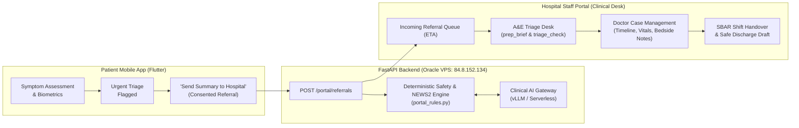

# VitaNet

**AI-Powered Health Triage, Emergency Referral, and Hospital Care Platform**

VitaNet is a comprehensive, two-sided digital health platform designed to bridge the gap between patients in distress and acute healthcare providers in Ghana. It pairs an accessible **Patient Mobile & Web Application** with an acute **Hospital Staff Portal** and a specialized **Conversational Medical AI Model**.

---

## 🌟 The Two-Sided Platform



### 1. Patient Mobile & Web Application (`lib/`)
* **AI Health Triage Chat**: Conversational clinical triage asking contextual follow-up questions to assess urgent vs routine concerns.
* **Biometrics & Vitals Tracking**: Integration with Apple Health / Android Health Connect for Blood Pressure, SpO₂, Heart Rate, and Blood Glucose.
* **Emergency Hospital Referral**: Patients flagged as `urgent` can send their clinical summary directly to the nearest A&E with explicit consent.
* **Care Circles**: Family and emergency contact network automatically alerted during crises.
* **Health Knowledge Library**: Curated localized articles, video shorts, first-aid protocols, and medication guides.

### 2. Hospital Staff Portal (`vitanet-backend/`)
* **Real-time Referral Inbox**: Incoming pre-arrival patient cases with live ETA from patient coordinates.
* **Triage & Bed Assignment**: Automatic ward suggestions (`Resus`, `Emergency`, `ICU`, `Minors`) based on live capacity and clinical severity.
* **Case Lifecycle Tracking**: Full patient progression tracking (`expected` → `waiting` → `treatment` → `discharged`).
* **Clinical Safety & Deterioration Alerts**: Room-air NEWS2 early warning score calculation with threshold notifications.
* **Full Clinical Audit Trail**: Complete immutable logging of every staff action, prescription order, and bed movement.

### 3. Clinical AI & Machine Learning Ecosystem (`ml-service/`)
* **Active Model Development (`vitanet-model`)**: Standalone conversational clinical reasoning model fine-tuned for Ghanaian healthcare (English and Twi).
  * Five automated hospital tasks: `prep_brief` (nurse pre-arrival checklist), `triage_check` (walk-in triage verification), `discharge_draft` (patient-friendly take-home instructions), `handover_note` (SBAR shift handovers), and `structure_note` (clinical NLP).
  * Specifications: [`docs/portal-ai-model-spec.md`](./docs/portal-ai-model-spec.md) and [`docs/AI_MODEL_INTEGRATION_PLAN.md`](./docs/AI_MODEL_INTEGRATION_PLAN.md).
* **Deterministic Guardrails**: Outer safety layer enforcing zero invented numbers, allergy contraindication blocking, and deterministic triage fallbacks via [`portal_rules.py`](./vitanet-backend/app/services/portal_rules.py).
* **Archived Legacy Prototype (`legacy_v1/`)**: Previous 377-symptom XGBoost tabular classifier preserved in [`ml-service/legacy_v1/`](./ml-service/legacy_v1/) for historical benchmarks.

---

## 📁 Repository Structure

```
vitanet/
├── lib/                     # Flutter mobile & web application
│   ├── app/                 #   App routing (GoRouter) & theme definitions
│   ├── core/                #   Constants, providers, and shared state
│   ├── data/                #   Data models, repositories, and API clients
│   ├── features/            #   Feature modules (assessment, auth, chat, portal, vitals, ...)
│   ├── shared/              #   Reusable UI kit (vn_kit) & utilities
│   └── main.dart            #   Application entry point
│
├── vitanet-backend/         # FastAPI production backend
│   ├── app/
│   │   ├── core/            #   Configuration, security & settings
│   │   ├── database/        #   SQLAlchemy engine & session management
│   │   ├── models/          #   ORM models (PortalCase, PortalWard, Referral, Vitals, Staff)
│   │   ├── routes/          #   Endpoints (/portal, /triage, /vitals, /chat, ...)
│   │   ├── schemas/         #   Pydantic validation schemas
│   │   └── services/        #   Business logic, AI agent orchestration, and portal_rules
│   ├── alembic/             #   Database schema migrations
│   ├── test_portal.py       #   Hospital portal test suite
│   ├── test_production_backend.py # Production integration test suite
│   └── requirements.txt     #   Backend Python dependencies
│
├── ml-service/              # Machine learning integration directory
│   ├── new_model/           #   🌟 Active AI model integration workspace
│   ├── legacy_v1/           #   📦 Archived v1 XGBoost prototype & notebooks
│   ├── data/                #   Clinical reference datasets (disease_diagnosis.csv)
│   └── app/                 #   Non-breaking backward compatibility stubs
│
├── docs/                    # Architecture and design specifications
│   ├── AI_MODEL_INTEGRATION_PLAN.md # Master AI system & portal implementation plan
│   ├── HOSPITAL_PORTAL_PLAN.md      # Hospital portal architecture & specs
│   ├── portal-ai-model-spec.md      # AI clinical task contracts & JSON schemas
│   ├── VitaNet App Redesign.pdf     # Source of truth for mobile UI redesign
│   ├── archive/             #   Archived historical ML documentation
│   └── README.md            #   Documentation index
│
├── assets/                  # Images, logos, medical illustrations, and health catalogs
├── landing/                 # Public landing page (HTML/CSS/JS)
├── scripts/                 # Maintenance, deployment, and testing utilities
└── test/                    # Flutter unit & widget test suites
```

---

## 🚀 Getting Started

### 1. Flutter Mobile / Web Client

```bash
# Get dependencies
flutter pub get

# Run on Chrome (Web)
flutter run -d chrome --web-port 5000

# Run on connected mobile device / emulator
flutter run
```

### 2. VitaNet Backend API

```bash
cd vitanet-backend

# Setup virtual environment
python -m venv .venv
source .venv/bin/activate  # Or on Windows: ..\.venv\Scripts\activate

# Install dependencies
pip install -r requirements.txt

# Run migrations
alembic upgrade head

# Start local server
uvicorn app.main:app --reload --port 8000

# Run automated tests
python test_production_backend.py
python test_portal.py
```

---

## 🛠️ Tech Stack

| Layer | Technologies |
|---|---|
| **Mobile & Web App** | Flutter 3.x, Dart, Riverpod, GoRouter, VN Kit UI |
| **Backend API** | FastAPI, Python 3.12, SQLAlchemy, Alembic, PostgreSQL |
| **Authentication** | Firebase Auth (Email, Google, Anonymous, Staff Roles) |
| **Hosting & Cloud** | Oracle Cloud VPS (`84.8.152.134`), Firebase Hosting |
| **Clinical Reasoning AI** | Fine-tuned Qwen 2.5/Llama 3.1 LLM, OpenRouter API fallback |
| **Safety & Triage** | NEWS2 deterministic engine, Ghana Standard Treatment Guidelines |
