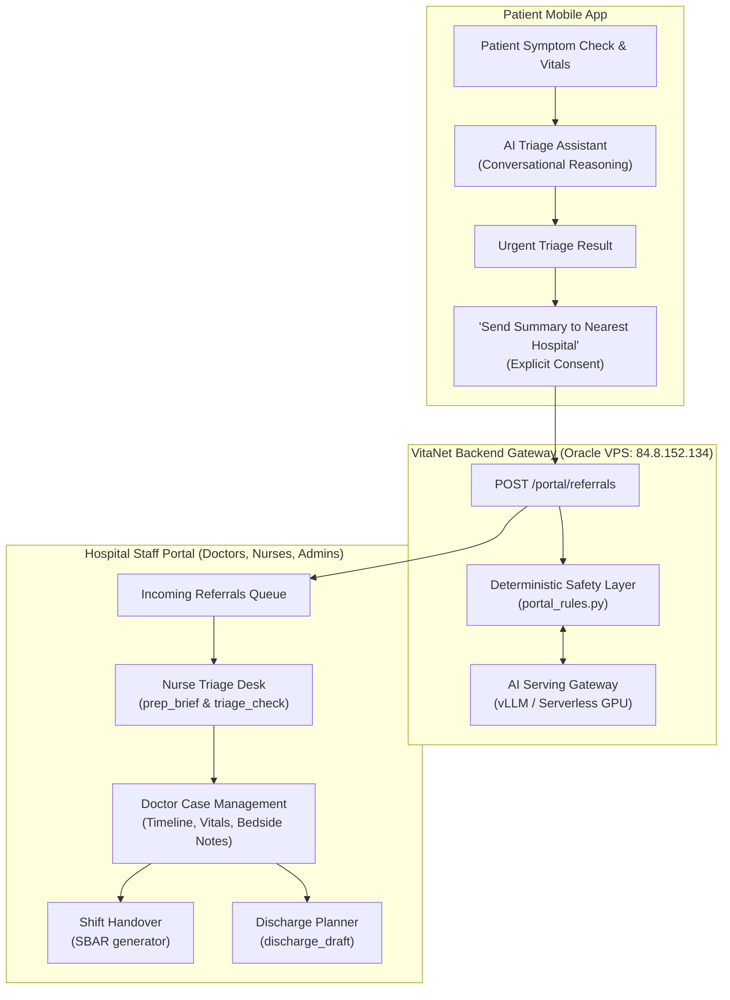

# VitaNet AI Model — Full System Implementation Plan

This document is the master architectural and implementation roadmap connecting the **VitaNet Mobile App**, the **Hospital Staff Portal**, and the **Standalone AI Model** ([`vitanet-model`](file:///C:/Users/CARLVYN/Desktop/Vitanet%20AI%20Model/vitanet-model)).

---

## 1. System Vision & The Two-Sided Platform

VitaNet's AI is **not just a patient chatbot**. It is an end-to-end clinical intelligence system linking patients in distress to the hospital teams preparing to treat them:

---

## 2. Model Task Contracts & Schema Specifications

The new AI model is fine-tuned to execute **5 core clinical tasks** with strict JSON input/output schemas:

### Task 1: `prep_brief` (Nurse Pre-Arrival Brief)
- **Trigger**: Patient submits an urgent/doctor triage referral to a hospital.
- **Input**: `task, triage_level, age, sex, complaint, triage_summary, allergies[], medications[], conditions[], vitals{}, eta_minutes, wards[{name, free}]`.
- **Output**:
  - `possible_conditions[]` (max 3, clinical suggestions only).
  - `red_flags[]` (vital signs out of range, high-risk symptoms).
  - `prepare[]` (3–6 concise bedside items, e.g. "12-lead ECG on arrival", "IV access").
  - `avoid[]` (strictly flags contraindicated drugs from allergies).
  - `suggested_ward` (must be a ward from input with `free > 0`).
  - `suggested_level` (`urgent`, `doctor`, or `routine`).
  - `one_line` (concise summary under 120 characters).

### Task 2: `triage_check` (Walk-In Emergency Intake)
- **Trigger**: Nurse inputs a walk-in patient or re-triages a waiting patient.
- **Input**: `task, age, sex, complaint, vitals{heart_rate, bp_systolic, bp_diastolic, spo2, temperature, respiratory_rate, pain, alert}, allergies[]`.
- **Output**:
  - `level` (`urgent`, `doctor`, `routine`).
  - `reasons[]` (max 4 justification points).
  - `red_flags_to_watch[]` (max 4 warning signs).
  - `first_steps[]` (max 4 immediate nurse stabilization actions).
- **Hard Urgent Escalation**: SpO₂ < 92%, HR > 130 or < 40, systolic BP < 90, not alert, stroke signs, active seizures, severe bleeding.

### Task 3: `discharge_draft` (Patient-Facing Take-Home Instructions)
- **Trigger**: Clinician prepares to discharge a patient (`home`, `admitted`, `transferred`, `left`).
- **Input**: `task, patient_name, age, sex, complaint, outcome, admitted_to, allergies[], timeline[], latest_vitals{}`.
- **Output**:
  - `summary` (max 3 sentences at a **12-year-old reading level**).
  - `what_next` (practical recovery advice, max 3 sentences).
  - `medicines[]` (only medicines documented in the chart; no invented drugs).
  - `warning_signs[]` (2–4 specific signs: "Call 112/193 or return immediately if...").
  - `follow_up` (clinic review timeline or null).

### Task 4: `handover_note` (SBAR Shift Handover)
- **Trigger**: Clinician shift ends; outgoing doctor hands over cases to incoming doctor.
- **Input**: `task, patient{name, age, sex, level, status, ward, bed}, complaint, allergies[], timeline[], latest_vitals{}, early_warning_score, to`.
- **Output**:
  - `situation` (max 160 chars).
  - `background` (max 160 chars).
  - `assessment` (max 160 chars).
  - `recommendation` (max 160 chars).
  - `pending[]` (only awaited investigations/lab results).

### Task 5: `structure_note` (Doctor Dictation / Clinical NLP)
- **Trigger**: Doctor or nurse records free-text or voice notes during ward rounds.
- **Input**: `task, text`.
- **Output**: `clean_text, vitals{}, medications_given[{name, dose, route}]`.

---

## 3. Tool Architecture (Function Calling Matrix)

The model operates with two distinct toolboxes depending on the user context:

### Patient-Facing Toolbox (Mobile App)
1. `get_health_metrics`: Read latest recorded vitals and 7-day trends.
2. `get_health_profile`: Read chronic conditions, allergies, biological sex, age.
3. `get_care_circle`: Fetch emergency contacts.
4. `get_nearby_hospitals`: Rank nearby A&E clinics by distance & ambulance readiness.
5. `check_symptoms_ml`: Execute symptom triage inference.

### Hospital-Facing Toolbox (Staff Portal)
1. `prep_brief_copilot`: Generates Task 1 pre-arrival brief.
2. `walkin_triage_checker`: Validates walk-in intake priority and red flags.
3. `calculate_news2_score`: Standardized NEWS2 physiological score calculation.
4. `generate_sbar_handover`: Aggregates case events into standard SBAR notes.
5. `structure_clinical_notes`: Parses round notes into structured clinical entities.
6. `allergy_prescription_guard`: Validates drug safety against patient chart.
7. `check_ward_capacity`: Reads real-time bed availability from `PortalWard`.
8. `balance_clinician_workload`: Matches incoming referrals to least-burdened on-duty doctor.

---

## 4. Safety Architecture & Deterministic Fallbacks

The AI model is an assistive copilot, **never a black-box decision maker**:

1. **Outer Safety Guardrails**:
   - `portal_rules.py` enforces hard NEWS2 scoring and ward allocation deterministically.
   - If the AI service is offline, slow (>20s), or returns invalid JSON, the portal automatically falls back to deterministic rule outputs.
2. **Zero Invention of Numbers**:
   - Every number (vitals, lab results) in the output MUST exist in the input payload.
3. **Zero Allergy Violations**:
   - Code-level validation in `portal.py` blocks medication orders if the patient has a documented allergy.
4. **Clinical Labeling & Audit Logging**:
   - All AI suggestions are visibly tagged *"AI suggestion"* and recorded in `PortalAuditLog`.
   - Clinicians can edit any field before final submission.

---

## 5. Implementation Roadmap & Timeline

| Phase | Milestone | Key Deliverables | Status |
|---|---|---|---|
| **Phase 1** | **Backend & Portal Foundation** | Database models (`PortalCase`, `PortalWard`, `PortalReferral`), deterministic rules (`portal_rules.py`), REST APIs (`/portal/*`), and unit/integration tests. | ✅ **Complete & Verified** |
| **Phase 2** | **Model Training & Benchmarking** | Standalone repo (`vitanet-model` on Desktop). Benchmark suite, Qwen base fine-tuning (LoRA), and clinical evaluation against Ghana STG guidelines. | 🚀 **In Progress** |
| **Phase 3** | **Serving Bridge Integration** | Setup serving endpoint (vLLM / Serverless GPU) connected to `ml-service/new_model/`. Implement `/chat/completions` client in VitaNet backend. | ⏳ **Next** |
| **Phase 4** | **Shadow-Mode Testing (Staging)** | Run model alongside deterministic rules in hospital staging environment. Clinicians review AI drafts for 100 simulated cases. | ⏳ **Planned** |
| **Phase 5** | **Live Pilot with Partner Clinic** | Real hospital pilot with ~10 clinicians under medical oversight. | ⏳ **Future** |
